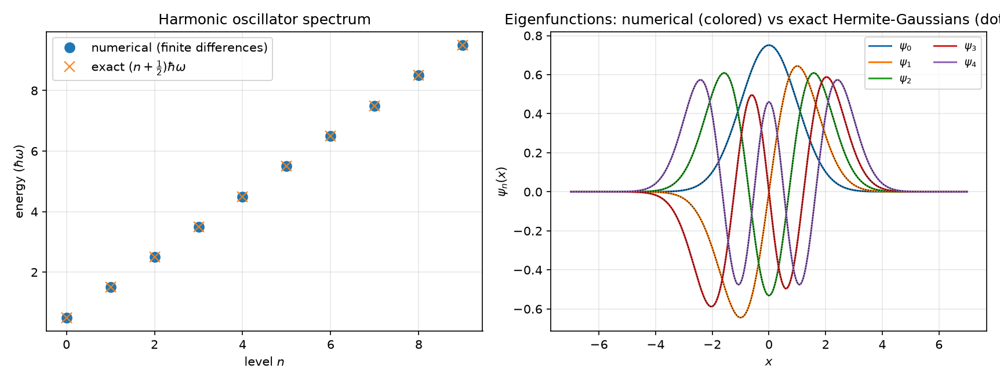
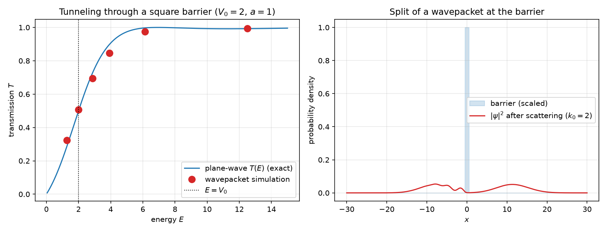
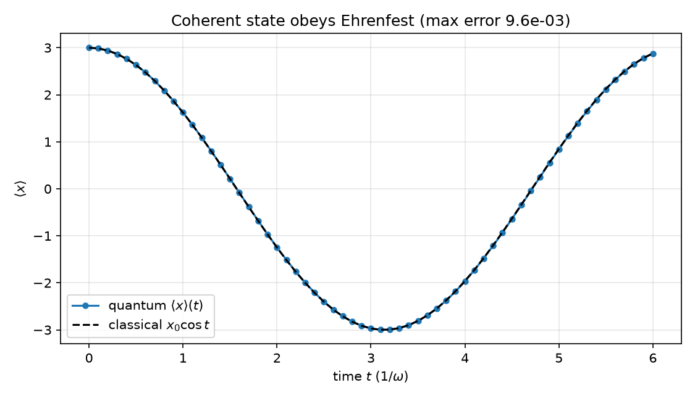

# schrodinger-lab — quantum mechanics you can watch

Numerical quantum mechanics from scratch: two independent time-evolution
engines (Crank–Nicolson and Fourier split-operator), bound-state spectra,
wavepacket tunneling, and a coherent state sloshing in a trap — every
number validated against the exact formulas (ħ = m = 1).

## What it reproduces

| Quantity | Exact | This code |
|---|---|---|
| Harmonic oscillator spectrum, 10 levels | $E_n = (n+\tfrac{1}{2})$ | max dev. **4×10⁻⁴** ✓ |
| Ground-state wavefunction | $\pi^{-1/4}e^{-x^2/2}$ | max diff 10⁻⁴ ✓ |
| Infinite well, 6 levels | $n^2\pi^2/2L^2$ | within 0.5% (O(dx²)) ✓ |
| Norm conservation (600 CN steps) | 1 | 1 ± 10⁻¹⁰ ✓ |
| Energy conservation | ⟨H⟩ const | drift < 10⁻⁸ rel ✓ |
| CN vs split-operator overlap (independent engines) | 1 | 0.99984 ✓ |
| Ehrenfest: coherent state ⟨x(t)⟩ vs $x_0\cos t$ | classical | max err **0.0096** ✓ |
| Free Gaussian spreading | $\sigma(t)=\sigma_0\sqrt{1+(t/\sigma_0^2)^2}$ | within 2% ✓ |
| **Tunneling transmission** (6 configs, E below/at/above $V_0$) | exact $T(E)$ convolved with packet spectrum | **max diff 0.002** ✓ |

| | |
|---|---|
|  | Spectrum and eigenfunctions vs Hermite–Gaussians. |
|  | Transmission vs energy: simulation points on the exact curve, and the packet splitting at the barrier. |
|  | Ehrenfest theorem live: the quantum expectation rides the classical oscillator. |

**Animation**: `figures/coherent_state.gif` — a coherent state oscillating in
the harmonic trap for a full period, keeping its shape (that's what makes it
"coherent": the closest quantum thing to a classical pendulum).

## The physics engine

- **Crank–Nicolson**: $(I + iH\delta t/2)\psi' = (I - iH\delta t/2)\psi$ with
  pre-factorized sparse tridiagonal solves — unconditionally stable, exactly
  unitary.
- **Split-operator**: Strang splitting $\exp(-iV\delta t/2)\,F^{-1}\exp(-ik^2\delta t/2)F\,\exp(-iV\delta t/2)$ —
  spectral kinetic accuracy, zero code shared with CN, so their agreement is
  itself a test.
- **Spectra**: sparse diagonalization (Lanczos) of the finite-difference
  Hamiltonian.

## Honest measurement: wavepackets are not plane waves

The textbook $T(E)$ formula assumes a monoenergetic plane wave; a Gaussian
packet carries a momentum spread. The measurable transmission is the
plane-wave $T(E)$ **convolved with the packet's momentum distribution** —
that is what the simulation is compared against (and it agrees to 0.002).

Finding this the hard way fixed a real bug: the initial "exact" comparison
used the wrong wavenumber in the $E > V_0$ branch ($k$ instead of
$k_2=\sqrt{2(E-V_0)}$); the *simulation* was right and the *formula* was
wrong. Tests caught the discrepancy — the pipeline works.

## Repository layout

```
schrodinger-lab/
├── src/sqm/
│   ├── grid.py        # grids, potentials, Gaussian packets, coherent states
│   ├── solvers.py     # Crank-Nicolson + split-operator propagators
│   ├── stationary.py  # bound states by sparse diagonalization
│   ├── dynamics.py    # observables: norm, ⟨x⟩, ⟨p⟩, ⟨H⟩, width, T
│   └── analytic.py    # exact formulas (spectra, T(E), spreading)
├── scripts/run_oscillator.py   # spectrum + eigenfunctions figure
├── scripts/run_tunneling.py    # T(E) measurement vs exact
├── scripts/run_coherent.py     # Ehrenfest + GIF
├── tests/             # 15 physics tests (pytest)
└── figures/, results/ # plots, GIF, CSV data (committed)
```

## Quickstart

```bash
python -m venv .venv
# Windows: .venv\Scripts\activate   |   Linux/macOS: source .venv/bin/activate
pip install -r requirements.txt
pip install -e .

pytest                          # 15 physics tests, ~2 s
python scripts/run_oscillator.py
python scripts/run_tunneling.py
python scripts/run_coherent.py  # writes the GIF too
```

## Roadmap

- [ ] 2D: wavepacket scattering on a double slit (interference pattern)
- [ ] Resonant tunneling through a double barrier
- [ ] Absorbing boundaries (complex absorbing potential) instead of big boxes
- [ ] Time-dependent potentials and wavepacket revivals

## References

- Griffiths, *Introduction to Quantum Mechanics* (packet spreading, T(E), Ehrenfest)
- Iserles, *A First Course in the Numerical Analysis of Differential Equations* (Crank–Nicolson)
- Feit, Fleck & Steiger, *Computation of mode structure in optical fiber* (split-operator, 1982)

## License

MIT — see [LICENSE](LICENSE).
